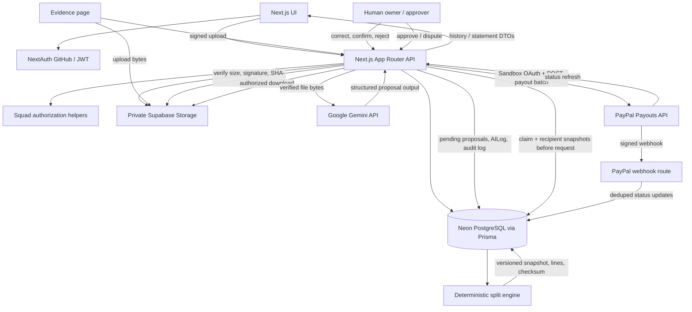

# MicroSplit AI — Technical Handoff to Antigravity

**Audit date:** 2026-11-03  
**Repository:** `MicroSplit-AI`  
**Branch at audit:** `main`  
**HEAD at audit:** `1a45aea` (`feat: add Gemini evidence extraction and resilient proposal review`)

This handoff reflects the checked-in source plus the existing uncommitted worktree. It does not include credentials, environment-file contents, database URLs, tokens, or other secret values. No application code or database data was changed for this audit.

## Executive summary

MicroSplit AI is a Next.js application for managing squads, recording revenue, reviewing contribution evidence, calculating deterministic split snapshots, and orchestrating PayPal Payouts API batches.

The evidence and persisted split-run foundations are implemented. The user reports that evidence upload/storage/download/review and Gemini extraction have been manually exercised, including a known-contributor PDF and an unknown-contributor PDF. The code keeps Gemini results as pending proposals; identity matching is exact-only, and contribution review is a separate human step.

The persisted PayPal workflow is implemented in the current worktree, but the live Sandbox demo is externally blocked. The PayPal Developer Dashboard screenshot reported by the user says:

> Endpoint: `POST /v1/payments/payouts` — HTTP 403 — “You live in a country that is not allowed to send this payout.”

Prior diagnostics established Sandbox OAuth HTTP 200, a generated token with the Payouts scope, and use of the Sandbox API host. The current `$10.00` payout claim consists of two `$5.00` items; it is persisted as `submission_unknown` with no PayPal batch ID saved. The sender batch ID is `01603e08029d6495e291d714eec029`. The missing local PayPal batch ID does **not** prove PayPal did not receive the batch.

**Do not retry that payout, delete or release its claim, generate another payout for it, switch to Live, or falsify an account country.** First verify the Sandbox sender account's country and whether a legitimate eligible-country Sandbox Business account can be used for the demo.

## Product and end-to-end workflow

The product targets creator squads, agencies, and open-source teams that need a reviewable way to attribute revenue, snapshot a split, obtain approval, and submit batch payouts.

1. A user signs in with GitHub. The application persists a user and requires a verified primary GitHub email.
2. The user creates or joins a squad. Membership roles include `owner`, `approver`, `contributor`, and `viewer`. A squad can record revenue events in integer minor units and a currency.
3. Members upload evidence (PDF, image, CSV, text, or audio formats allowed by the validation helper) to a private Supabase Storage bucket using a signed upload URL. The server verifies bytes, size, file signature, and SHA-256 before marking the record ready for review.
4. An authorized squad member can download the stored file through an authenticated route. Squad owners/approvers review the evidence itself. A member can trigger Gemini extraction for eligible evidence.
5. Gemini returns structured contribution proposals, not financial allocations. The application validates output, normalizes dates where possible, and resolves identities only by a unique exact match against the squad's known user name, email, or GitHub username. Unresolved or ambiguous identities remain unassigned.
6. Contribution proposals are stored as `pending`. A permitted non-self owner/approver may correct the fields, assign a squad member, then confirm or reject. Only a confirmed, assigned contribution can be eligible for future split-related evidence use; pending/rejected proposals are excluded.
7. An owner/approver creates a split run for an active revenue event. The request supplies per-member percentages and rule configuration. The server applies deterministic calculations, saves the complete versioned snapshot and split lines, and computes a SHA-256 snapshot checksum.
8. An owner/approver reviews and approves or disputes the persisted run. Approval is persisted separately from the calculation.
9. Payout submission is USD-only and requires the approved persisted snapshot, checksum/conservation checks, and each recipient's explicitly confirmed PayPal email. A durable claim and item-level recipient/amount snapshots are committed before network I/O.
10. Payout status can be refreshed from PayPal or updated from verified PayPal webhooks. History is loaded from persisted payout rows for authorized reviewers; recipient emails are masked.

The split is not sent to PayPal merely because Gemini found a contribution. Human review, a deterministic run snapshot, approval, and recipient confirmation remain separate gates.

## Technology stack (verified)

Versions below are from `package.json`/installed `npm ls` output at audit time:

- Next.js **16.4.3**, App Router. `dev` and `build` scripts explicitly use `--webpack`; README's Turbopack description is stale.
- React / React DOM **19.3.0**.
- TypeScript **5.9.3** installed; package range is `^5`.
- Tailwind CSS **4.3.3**; design tokens and additional CSS are used in the UI.
- Prisma / Prisma Client **7.10.1**, with `@prisma/adapter-pg` **7.10.1** and `pg` **8.23.1**. The Prisma datasource is PostgreSQL; the configured database provider is Neon through `DATABASE_URL`.
- `@supabase/supabase-js` **2.118.0** for private evidence storage.
- `@google/genai` **2.31.0** for Gemini.
- `next-auth` **5.0.0-beta.32** with GitHub OAuth.
- PayPal Payouts v1 REST API, implemented with `fetch` (no separate PayPal SDK dependency).
- `framer-motion` **14.7.1**, `lucide-react` **1.62.0**, `recharts` **3.10.1**.
- No dedicated data-grid package is present; tables/lists are rendered with custom React components.
- Tests use Node's native test runner and Node's TypeScript strip-types flag.

The package does not declare a Node `engines` range. README's Node 26 statement should be checked and updated against the supported deployment/runtime policy.

## Architecture and important files

### Directory map

- `src/app/` — Next.js pages, layouts, and route handlers.
- `src/app/api/` — authenticated HTTP API endpoints.
- `src/components/` — shared navigation, analytics, focus widget, streak heatmap, and UI primitives.
- `src/lib/` — authorization, Prisma, evidence lifecycle, Gemini integration, deterministic split engine, payout client/safety, money, ledger, and sanitization helpers.
- `src/types/` — shared TypeScript types.
- `prisma/schema.prisma` — PostgreSQL data model.
- `prisma/migrations/` — ordered migrations.
- `tests/` — native Node test files.
- `public/` — static assets.

### Major pages

- `/` — landing/dashboard.
- `/login` — GitHub sign-in.
- `/squads`, `/squads/new`, `/squads/[id]` — squad and membership/revenue management.
- `/evidence` — evidence upload, extraction, evidence review, proposal correction/review.
- `/splits/new` — split-run creation UI.
- `/runs/[id]` — persisted run detail, review and Sandbox payout controls.
- `/payouts` — persisted payout history and explicit status refresh.
- `/statements` — member earnings statement.
- `/ledger` — ledger view.
- `/docs`, `/docs/api`, `/docs/arch`, `/privacy`, `/security`, `/terms`, `/licence`, `/contact` — product/docs/legal pages.

### API route inventory

- Auth: `src/app/api/auth/[...nextauth]/route.ts`
- Squads: `src/app/api/squads/route.ts`, `src/app/api/squads/[id]/route.ts`, `src/app/api/squads/[id]/members/route.ts`, `src/app/api/squads/[id]/revenue/route.ts`
- Evidence: `src/app/api/evidence/route.ts`, `src/app/api/evidence/[id]/route.ts`, `src/app/api/evidence/[id]/complete/route.ts`, `src/app/api/evidence/[id]/file/route.ts`, `src/app/api/evidence/contributions/[id]/route.ts`
- Split runs: `src/app/api/split-runs/route.ts`, `src/app/api/split-runs/[id]/route.ts`, `src/app/api/split-runs/[id]/approve/route.ts`, `src/app/api/split-runs/[id]/payout/route.ts`
- Payouts: `src/app/api/payouts/route.ts`, `src/app/api/payouts/[id]/reconcile/route.ts`, `src/app/api/webhooks/paypal/route.ts`
- Statements: `src/app/api/statements/route.ts`
- Focus sessions: `src/app/api/focus-sessions/route.ts`, `src/app/api/focus-sessions/start/route.ts`, `src/app/api/focus-sessions/[id]/route.ts`, `src/app/api/focus-sessions/[id]/stop/route.ts`, `src/app/api/members/opt-in/route.ts`
- Freeze grants: `src/app/api/freeze-grants/route.ts`
- Ledger: `src/app/api/ledger/route.ts`, `src/app/api/ledger/verify/route.ts`
- Contact: `src/app/api/contact/route.ts`

### Mermaid architecture and data flow



## Authentication and authorization

- `src/auth.ts` configures GitHub OAuth, requests `read:user user:email`, fetches the GitHub email list, and only accepts a verified primary email. It links by persisted GitHub ID and rejects an unlinked account that would collide with an existing user email.
- Auth sessions use JWTs with the persisted local user ID copied into `session.user.id`.
- `src/lib/authorization.ts` provides `requireAuthenticatedActor` and `requireSquadRole`; squad membership is queried by `(squadId, userId)`.
- `src/lib/authorization-policy.ts` contains role and extracted-contribution review rules. Extracted proposal correction/confirmation/rejection requires an owner/approver, pending status, and a reviewer who is neither the uploader nor assigned member.
- `src/proxy.ts` wraps protected UI paths with NextAuth and blocks requests matching sensitive-file paths. API routes also perform their own authorization; UI middleware is not the only control.
- Evidence listing/download is scoped to squad membership. Extraction accepts owner/approver/contributor squad roles. Evidence-level decisions and contribution review use owner/approver permissions. Payout history/reconciliation/submission are owner/approver-only.
- Payout destinations are private: membership APIs mask/omit other members' PayPal email values, and payout history uses masked addresses.

## Deterministic split engine

### Production persistence path

The persisted creation flow is in `src/lib/split-run-persistence.ts` and `src/app/api/split-runs/route.ts`. It validates identifiers, unique member allocations, bounded rule configuration, membership in the requested squad, and an active revenue event. It creates the run and its lines transactionally.

Current persistent split creation takes per-member percentages from the authorized request as the work weights. It computes the consistency component from confirmed contribution activity dates and freeze grants. It does **not** let Gemini set payout values or directly calculate a split.

### Allocation and snapshot rules

- Money is represented in integer minor units (`poolMinor`, `amountMinor`); the persistent run rejects invalid/non-positive pool values and checks the final allocation sum.
- `src/lib/consistency-streak.ts` implements `allocateByLargestRemainder` and `calculateConsistencySplit`. The consistency pool is `floor(poolMinor * consistencyPercent / 100)`, with a maximum configured percentage of 10%. The remainder is the work pool. Largest-remainder allocation uses deterministic ID tie-breaking. If all streak scores are zero, the consistency pool is returned to the work allocation so the total remains conserved.
- The invariant is `sum(finalAmountMinor) === poolMinor`; each line stores work and consistency amounts, streak days, freeze days used, and rationale.
- `computeStreakFromDates` counts consecutive local-calendar days in the member's IANA timezone; authorized freeze-grant dates preserve a streak. Contribution dates with no reliable date are not activity dates. For extracted contributions, `getContributionActivityDate` returns `null` if the canonical contribution date is unresolved rather than substituting creation time.
- Persistent calculation inputs include the rule config, currency, period end date, member inputs, contribution dates, freeze grant dates, and engine/version metadata in `ruleSnapshotJson`.
- Each split run increments `calculationVersion` for its revenue event. `computeSplitRunSnapshotChecksum` in `src/lib/split-run-persistence.ts` hashes the complete sorted snapshot and line fields with SHA-256.
- `src/app/api/split-runs/[id]/route.ts` returns the saved snapshot and persisted lines; historical runs are not recalculated on read.
- `src/lib/split-engine.ts` retains general split helpers and an older `computeSplitChecksum` demo helper. The persisted production snapshot path uses `computeSplitRunSnapshotChecksum`, not that legacy 32-bit helper.

### Evidence eligibility

`SPLIT_ELIGIBLE_CONTRIBUTION_STATUSES` in `src/lib/split-run-persistence.ts` is `["confirmed"]`. The Prisma query also scopes contributions to the requested squad and requested member IDs. A contribution must have a resolved `memberId`. Pending and rejected proposals are not queried. These confirmed contributions contribute to streak dates; current persisted work shares are still driven by the submitted member percentages.

Gemini's system instruction explicitly forbids inventing amounts, percentages, weights, payouts, or financial recommendations. The extraction output schema has no financial allocation fields. The API only persists proposals; only the separate human review route can confirm them.

## Evidence storage and Gemini workflow

### Storage and integrity

- `src/lib/evidence-storage.ts` creates a server-only Supabase client using the service-role key and a configured bucket. The bucket should remain private.
- `src/lib/evidence-workflow.ts` validates filename extension/MIME pairing, a maximum 10 MiB size, and file signatures (or UTF-8 content for text/CSV). The signed-upload workflow persists an `uploading` row with an idempotency key before issuing a signed upload URL. Idempotency reuse requires matching filename/MIME/size.
- `POST /api/evidence/[id]/complete` downloads the object server-side, verifies expected size and file bytes, calculates SHA-256, persists hash and `pending_review` status, and removes an invalid object on failure.
- `GET /api/evidence/[id]/file` checks session and squad membership, downloads from private storage server-side, and returns a private/no-store attachment with `nosniff`.
- Evidence metadata lives in Prisma (`Evidence`): squad/uploader, filename, storage key, idempotency key, hash, MIME type, size, lifecycle/review fields.

### Extraction, validation, and review

- `src/lib/gemini-client.ts` uses installed `@google/genai` and `GoogleGenAI`. It configures `httpOptions.timeout` and SDK retries to one attempt; transient retries are handled by the app helper instead. It requests JSON using `responseMimeType: "application/json"` and a structured Gemini `responseSchema`, temperature 0, and a bounded output-token count.
- Default model is `gemini-3.8-flash` in `src/lib/evidence-extraction.ts`; `GEMINI_MODEL` may override it. The default request timeout is 18 seconds; max is 50 seconds via `GEMINI_REQUEST_TIMEOUT_MS`. Longer deadlines use one attempt. `src/app/api/evidence/[id]/route.ts` declares `maxDuration = 60`, so a 50-second provider call leaves limited time for file retrieval, persistence, cold start, and response overhead. Hosting plan limits must be verified; asynchronous jobs are safer if real latency approaches the route limit.
- `parseEvidenceExtractionOutput` rejects malformed JSON, unsupported keys/types, empty/oversized descriptions, missing source references, invalid confidence ranges, and empty/too-many contribution lists. It rejects financial output fields.
- `normalizeContributionDate` accepts validated ISO, year-first numeric, unambiguous English month/day, and some numeric dates only where order can be inferred safely. It verifies actual calendar dates and returns `null` plus an explicit warning when interpretation is ambiguous/impossible. The original model output is retained in the extraction log; proposal fields hold normalized dates.
- `resolveEvidenceIdentity` compares exact normalized identifier strings against squad members' names, emails, and GitHub usernames. Only a unique exact match is assigned. Missing, ambiguous, or non-exact identifiers stay unresolved with a reason.
- `executeEvidenceExtraction` maps the validated content into `ProposedContribution`; `buildPendingContributionRecords` persists every proposal with `status: "pending"`. Date and identity uncertainty are represented in flags/warnings.
- `POST /api/evidence/[id]` verifies authentication, squad membership, evidence lifecycle, storage presence, and SHA-256 integrity before sending bytes to Gemini. It creates a database extraction claim and `AILog` attempt transactionally, persists output/proposals on success, and records failure categories on failure. Stale processing claims can be marked timed out and recovered after the configured stale window.
- Re-extraction is available for the supported lifecycle statuses, including already reviewed evidence; the backend claim prevents simultaneous duplicate extraction attempts. Extraction failures do not replace earlier successful extraction logs/proposals.
- `PATCH /api/evidence/contributions/[id]` permits an authorized, non-self reviewer to edit a pending proposal, resolve it to a member, correct its date, and confirm/reject. Confirming requires a member assignment; assigned member must be in the same squad, and self-assignment/review is blocked. Updates and audit rows are transactional.
- `Evidence` and `AILog` contain lifecycle/attempt state. `AuditLog` rows capture extraction completion/failure and contribution corrections/reviews with before/after details. `GET /api/evidence` returns extraction logs and proposals to authorized squad members.
- The Evidence page in `src/app/evidence/page.tsx` provides visible Run AI Extraction / Run Again controls for eligible evidence, loading/error handling, refresh, result proposals, date warnings, correction, and review actions. Status can display “Extraction completed with warnings” separately from failure.

### Prompt injection and privacy boundaries

`EXTRACTION_SYSTEM_INSTRUCTION` treats documents as untrusted data and instructs Gemini to ignore embedded instructions, not follow URLs, browse, call tools, execute code, approve decisions, or generate payouts. Text/CSV is delimited as untrusted document content; PDF/image/audio is sent as inline file bytes. There is no browser/tool execution in the extraction flow. This is a prompt-level defense, not a guarantee against model misbehavior; human review and strict schema/authorization gates remain essential.

Raw structured Gemini output is persisted in `AILog.outputJson`, and it is selected in evidence responses for squad viewers. Consider the data-retention/privacy implications before expanding that exposure.

### Gemini timeout and retry behavior

- `GEMINI_REQUEST_TIMEOUT_MS`: default 18,000 ms; max 50,000 ms.
- `maxDuration = 60` is set on the extraction route.
- `retryTransientGeminiRequest` applies bounded exponential backoff with jitter to retryable transient errors. HTTP 504 / `DEADLINE_EXCEEDED`, invalid/auth errors, and non-retryable quota conditions are not retried with the same deadline. For request deadlines longer than the default, maximum attempts is one.
- Diagnostics record model ID, attempt, configured timeout, evidence retrieval time, payload preparation time, Gemini call duration, total extraction time, retry count, provider status/code/details, error name, and sanitized message. No key, document bytes, or full document text should be logged.
- Manual user-reported testing covered a known-contributor PDF and an unknown-contributor PDF. The unknown identity remained unresolved. Automated tests inject/mock the generator; they are not real Gemini provider-level tests.

## PayPal Sandbox workflow

### Client and authorization gates

- `src/lib/paypal.ts` uses OAuth client credentials at the fixed Sandbox host `https://api-m.sandbox.paypal.com`. `PAYPAL_BASE_URL`, if set, is validated to exactly match the Sandbox origin; live hosts are rejected. There is no Live fallback.
- Requests use `AbortSignal.timeout`; default `PAYPAL_REQUEST_TIMEOUT_MS` is 4 seconds and maximum is 5 seconds. The client validates USD amounts and IDs before sending.
- The payout route (`POST /api/split-runs/[id]/payout`) requires an authenticated squad owner/approver, a persisted approved run with latest approval decision `approved`, USD currency, conserved integer lines, and a valid recomputed snapshot checksum.
- Every paid line must map to a current squad membership whose PayPal email has been explicitly confirmed. A new membership must not silently inherit the account email. Recipient snapshots are saved before provider I/O.

### Durable claim and idempotency

- `PayoutBatch.runId` is unique: one durable batch claim per run. `PayoutItem.senderItemId` is unique. The database transaction creates the batch and recipient/amount snapshots before the provider request.
- `createStablePayoutBatchId` and `createStablePayoutItemId` derive stable SHA-256 IDs and truncate them to 30 hex characters (PayPal request ID length constraint). The batch ID is reused in `PayPal-Request-Id`.
- A `submissionAttemptedAt` lease is saved. The route uses a 30-second stale-submission lease and supports a bounded six-hour same-ID retry window for eligible uncertain/stale claims if payload integrity still matches. This window is a code assumption; verify PayPal's actual idempotency retention before relying on it in production.
- Network/provider errors retain the unique claim and set `submission_unknown`; no fresh batch is created to bypass uncertainty. The local absence of a PayPal batch ID is not proof the provider did not accept a submission. Reconcile/check Sandbox before any retry.

### History, status and webhooks

- `GET /api/payouts` returns persisted batches only for squads where the caller is owner/approver. It joins batch/run/squad/line data and masks recipient emails.
- `POST /api/payouts/[id]/reconcile` fetches PayPal status and transaction items, persists mapped item/batch states transactionally, and marks a run paid only after a successful complete batch.
- `POST /api/webhooks/paypal` verifies the PayPal webhook signature before handling events. It persists event IDs/type in `PayPalWebhookEvent` to deduplicate. It does not store raw webhook payloads. Duplicate IDs are acknowledged without applying the event again. Batch/item status transitions are persisted.
- The UI at `/payouts` displays batch and item status and offers explicit refresh. `/runs/[id]` contains approval and Sandbox submission controls. `/statements` reads persisted approved/paid split-line data and payout status.
- Provider errors retain an uncertain claim. This protects against duplicate payments if the provider accepted a request but the response was lost or not parsed.

### Latest sanitized provider diagnostics

The latest diagnostic changes are uncommitted with the rest of the payout worktree:

- `src/lib/paypal.ts` extends `PayPalApiError` with a structured diagnostic containing HTTP status, provider `name`, `message`, up to 10 `details[].issue`/`details[].description` pairs, and `debug_id`. Malformed or absent JSON fields produce a safe minimal diagnostic.
- The sanitizer removes email addresses, recognized Basic/Bearer credentials, credential-like assignments, JWT-like tokens, and configured PayPal client values/cached access token. Values are bounded in length.
- `src/app/api/split-runs/[id]/payout/route.ts` logs these sanitized diagnostics with the local payout claim ID and returns a sanitized explanation/diagnostic object in the error response. The route requires an authorized owner/approver before reaching this point.
- Diagnostics are **logged and returned to the authorized caller; they are not persisted to a dedicated Prisma diagnostic column/table**. Server log retention/access therefore controls their auditability.
- Current tests in `tests/paypal-client.test.ts` cover `NOT_AUTHORIZED`, `PERMISSION_DENIED`, malformed JSON, missing optional fields, and redaction. Tests use mocked `fetch`; no payout API submission was made.
- Sanitization is pattern-based and cannot guarantee removal of every arbitrary sensitive string PayPal might include in a provider message. Review provider text before sharing logs outside the authorized developer team.

### Confirmed external country restriction — critical

The user-reported PayPal Developer Dashboard screenshot for the `MicrosplitAI` Sandbox application shows:

- `POST /v1/payments/payouts`
- HTTP 403
- “You live in a country that is not allowed to send this payout.”

Prior diagnostics established OAuth HTTP 200, a generated Sandbox token with the Payouts scope, and the Sandbox host. The user-provided country eligibility finding says India is listed as **“Receive and withdraw”**, not **“Send, receive, and withdraw.”** This points to a sender-account country eligibility restriction—not a split calculation or Gemini failure. The cited official eligibility reference is [PayPal Payouts supported features](https://developer.paypal.com/payouts/supported-features/).

This screenshot and country fact are user-provided evidence recorded in this handoff; they were not independently re-fetched during this repository-only audit. The next step is to verify the Sandbox sender account's country and determine whether an eligible-country Sandbox Business test account can legitimately be used for the demo. Do not falsify a real account's country or bypass PayPal restrictions.

The affected persisted payout is `$10.00` total, two `$5.00` items, status `submission_unknown`, no local PayPal batch ID, sender batch ID `01603e08029d6495e291d714eec029`. **Do not retry it, clear/delete/release its claim, or generate another batch as a workaround.** Check the Sandbox account for the sender batch ID before any later recovery decision.

## Database and migrations

`prisma/schema.prisma` defines users, squads, memberships, revenue events, split rules, evidence, contributions, split runs/lines, approvals, payout batches/items, webhook event IDs, ledger events, AI logs, audit logs, freeze grants, and focus sessions.

Migration directories in chronological order:

1. `20261026000000_initial_schema` — initial relational schema, foreign keys, core uniqueness/indexes for users, squads, revenue, evidence/contributions, runs/lines, approvals, payout records, ledger, AI logs, and audit logs.
2. `20261027_consistency_focus_sessions` — membership timezone/opt-in, split-line work/consistency/streak/freeze fields, `freeze_grants`, and `focus_sessions`.
3. `20261102093000_add_github_identity` — GitHub ID column and unique index on users.
4. `20261102183000_persist_split_run_snapshots` — calculation version and rule snapshot on split runs; membership relation on split lines; indexes for version lookup.
5. `20261103000000_persist_evidence_storage` — nullable legacy URL/hash fields; storage key, upload idempotency, review metadata; indexes and reviewer relationship.
6. `20261103010000_gemini_evidence_extraction` — GitHub username; nullable/resolved contribution identity and content/date/review fields; AI log attempt/error/completion fields; backfill of attempts and existing matched identities; uniqueness/indexes and relations.
7. `20261103020000_persist_paypal_payout_workflow` — recipient-confirmation timestamp, payout recipient snapshots, duplicate-run guard (fails if existing duplicates are present), and durable webhook event deduplication table.
8. `20261103030000_add_payout_submission_lease` — `payout_batches.submission_attempted_at`.

The read-only `npx prisma migrate status` check during this audit reported **database schema up to date**. No migration was applied. Earlier project work also reported that the evidence and Gemini migrations had been applied; the current status check covers the connected database at audit time.

## Environment and local setup

`.env.example` contains names/placeholders only; it is not proof that each value is configured in every environment. Do not read or share `.env`/`.env.local`.

### Environment variable names

Server-side or secret-bearing:

- `DATABASE_URL` — PostgreSQL/Neon connection string.
- `AUTH_SECRET`, `AUTH_URL`, `AUTH_GITHUB_ID`, `AUTH_GITHUB_SECRET` — NextAuth/GitHub authentication configuration.
- `SUPABASE_URL` (code also accepts `NEXT_PUBLIC_SUPABASE_URL` as a URL fallback), `SUPABASE_SERVICE_ROLE_KEY`, `SUPABASE_STORAGE_BUCKET` — private evidence storage. Service-role key must remain server-only.
- `GEMINI_API_KEY`, `GEMINI_MODEL`, `GEMINI_REQUEST_TIMEOUT_MS` — Gemini. Model default is `gemini-3.8-flash`; timeout defaults to 18,000 ms and caps at 50,000 ms.
- `PAYPAL_CLIENT_ID`, `PAYPAL_CLIENT_SECRET`, `PAYPAL_BASE_URL`, `PAYPAL_WEBHOOK_ID`, `PAYPAL_REQUEST_TIMEOUT_MS` — PayPal Sandbox client, webhook verification, and bounded request timeout. Use Sandbox app credentials and Sandbox base URL only.

Public/UI-configurable names in `.env.example`:

- `NEXT_PUBLIC_APP_URL`
- `NEXT_PUBLIC_GA_ID`
- `NEXT_PUBLIC_WHATSAPP_PHONE`

`NODE_ENV` is consumed by the Prisma client setup. NextAuth also recognizes its documented environment conventions.

### Service setup

1. Install the lockfile dependencies with `npm ci`.
2. Create local environment configuration from `.env.example` without committing actual secrets.
3. Configure the Neon PostgreSQL URL and run Prisma generation/migrations only after reviewing the migration and obtaining approval for database changes.
4. Create a **private** Supabase Storage bucket matching `SUPABASE_STORAGE_BUCKET`; allow the local/deployed application origins in Storage CORS. Keep the service-role key server-only.
5. Configure a Gemini API key and a supported model name. Set timeout conservatively; the 50-second setting leaves little slack under the route's 60-second `maxDuration`.
6. Create/use PayPal Sandbox Business and REST app credentials, enable/verify Payouts API access, and configure the webhook ID/URL. The current sender-country eligibility error is a blocker; do not use Live or misrepresent country.
7. Start locally with `npm run dev`; production build with `npm run build`.

### Documentation gaps

- `.env.example` provides placeholders but does not document the full service-console setup or deployment secrets management.
- Code supports `NEXT_PUBLIC_SUPABASE_URL` fallback but `.env.example` only documents `SUPABASE_URL`.
- Verify NextAuth/GitHub configuration names against the deployed provider setup.
- README describes Turbopack while scripts use webpack and refers to old/demo UI/test behavior.
- Confirm actual deployment execution limits and webhook configuration in the hosting dashboard; those are not inferable from source alone.

## Tests and verification

`npm test` invokes:

```text
node --experimental-strip-types --test
  tests/consistency-streak.test.ts
  tests/authorization-policy.test.ts
  tests/split-run-persistence.test.ts
  tests/evidence-workflow.test.ts
  tests/payout-safety.test.ts
  tests/paypal-client.test.ts
```

Test groups cover:

- `tests/consistency-streak.test.ts` — consistency pool bounds, largest remainder behavior, caps, freeze dates, timezone boundary, and 10,000 randomized conservation cases.
- `tests/authorization-policy.test.ts` — authentication/role gates and self-review restrictions for pending extraction proposals.
- `tests/split-run-persistence.test.ts` — input validation, deterministic allocation, contribution eligibility/unresolved dates, snapshot versioning, transaction rollback, and authorization policy.
- `tests/evidence-workflow.test.ts` — file metadata/bytes, storage lifecycle, upload idempotency/cleanup, schema validation, date normalization/warnings, exact identity mapping, pending proposal persistence, claim concurrency, retries/timeouts, and review transitions.
- `tests/payout-safety.test.ts` — approval parsing, recipient confirmation/masking, stable IDs, and payout status mapping/aggregation.
- `tests/paypal-client.test.ts` — mocked `fetch` for Sandbox host enforcement, stable request ID, error sanitization/diagnostics, and ID validation.

Latest diagnostic task results reported and verified in the session:

- `npm test`: **63 passed, 0 failed**.
- `npx tsc --noEmit`: passed.
- `npm run build`: passed.
- `git diff --check`: passed.

These are not proof of a real Gemini provider response or a real PayPal payout. The PayPal tests use mocks. Gemini tests use injected generators; user-reported manual PDFs exercise the Gemini integration but do not constitute a passing PayPal transaction.

### Missing integration coverage

- No PostgreSQL concurrency integration test was found for simultaneous payout claims, approval-vs-payout races, webhook/reconcile races, or stale lease recovery.
- No route-level end-to-end test covers payout submission persistence and provider failure against a disposable test database.
- No real PayPal Sandbox payout has been confirmed successful; current Sandbox payout is blocked by the country eligibility response.
- No provider-level Gemini test is run by `npm test`; run a controlled manual request only when suitable credentials, cost limits, and hosting time budgets are available.
- Adversarial prompt-injection coverage is not apparent in the current extraction tests.

## Current project status

| Feature | Implementation status | Relevant files | Verification status | Remaining work |
|---|---|---|---|---|
| GitHub sign-in / persisted user | Implemented | `src/auth.ts`, `src/lib/authorization.ts`, `src/proxy.ts` | Source inspected; prior app tests/type checks passed | Validate deployed OAuth settings and account-linking behavior |
| Squad and membership management | Implemented, mixed with demo/mock surfaces | `src/app/api/squads/**`, `src/app/squads/**` | Source inspected | Check any remaining mock data paths before demo |
| Revenue event persistence | Implemented | `src/app/api/squads/[id]/revenue/route.ts`, Prisma `RevenueEvent` | DB-backed revenue rows; ledger side is mock-backed | Make ledger persistence consistent if ledger is intended as production audit trail |
| Evidence upload/storage/download/review | Implemented and user-reported manually verified | `src/lib/evidence-workflow.ts`, `src/lib/evidence-storage.ts`, `src/app/api/evidence/**`, `src/app/evidence/page.tsx` | User reports upload, storage, protected download, and review tested | Verify deployed CORS/private bucket and monitoring |
| Gemini extraction and pending proposals | Implemented; user-reported manually exercised with known/unknown PDF | `src/lib/gemini-client.ts`, `src/lib/evidence-extraction.ts`, `src/app/api/evidence/[id]/route.ts` | Automated injected-generator tests pass; manual PDFs reported; unknown identity stays unresolved | Add rate/spend controls and adversarial prompt-injection/provider-level test strategy |
| Contribution correction/review | Implemented | `src/app/api/evidence/contributions/[id]/route.ts`, `src/lib/authorization-policy.ts` | Automated policy/date/workflow tests pass | Route/database integration tests |
| Deterministic split engine | Implemented | `src/lib/consistency-streak.ts`, `src/lib/split-run-persistence.ts`, `src/app/api/split-runs/route.ts` | Persistence/conservation/version tests pass | Ensure product copy distinguishes submitted percentages from evidence-based work weights |
| Split snapshots and approval | Implemented | `prisma/schema.prisma`, `src/app/api/split-runs/[id]/approve/route.ts`, `src/app/runs/[id]/page.tsx` | Snapshot and authorization tests; prior checks passed | Integration test concurrent approval and payout |
| PayPal recipient confirmation and durable claim | Implemented | `src/app/api/squads/[id]/members/route.ts`, `src/app/api/split-runs/[id]/payout/route.ts`, `src/lib/payout-safety.ts` | Pure helper and mocked client tests pass | Verify eligible Sandbox sender account and run end-to-end only after blocker is resolved |
| PayPal Sandbox submission | Blocked by external provider country eligibility | `src/lib/paypal.ts`, `src/app/api/split-runs/[id]/payout/route.ts` | OAuth/scope verified in prior diagnostics; payout call returned country-related 403 per user screenshot | Do not retry affected claim; verify legitimate eligible Sandbox Business account |
| Payout history/reconciliation | Implemented but not successfully manually verified against a completed real batch | `src/app/api/payouts/route.ts`, `src/app/api/payouts/[id]/reconcile/route.ts`, `src/app/payouts/page.tsx` | Helper/mock tests and build pass | End-to-end test with an eligible Sandbox account |
| PayPal webhook signature/dedup | Implemented | `src/app/api/webhooks/paypal/route.ts`, `PayPalWebhookEvent` model | Source inspected; no full route/database integration test | Test signatures, duplicates, out-of-order events and status reconciliation |
| Member statement | Implemented, some display values remain placeholders | `src/app/api/statements/route.ts`, `src/app/statements/page.tsx` | Build/type checks pass | Streak/freeze summary has hard-coded values; Export CSV button currently has no handler |
| Ledger | Partially implemented / demo-backed | `src/lib/ledger.ts`, `src/app/api/ledger/**`, `src/lib/mock-data.ts` | Hash helper exists; endpoint verifies/displays in-memory mock events | Replace demo in-memory ledger with durable `LedgerEvent` persistence if production auditability is required |
| Focus sessions | Partially implemented / in-memory mock-backed | `src/app/api/focus-sessions/**`, `src/components/FocusSessionWidget.tsx`, Prisma `FocusSession` | Some policy tests exist; API routes use `mockFocusSessions` | Persist session records or clearly isolate as demo; wire UI opt-in/status to actual membership data |
| Freeze grants | Partially implemented | `src/app/api/freeze-grants/route.ts`, Prisma `FreezeGrant` | Grant row is persisted; related ledger event is appended to in-memory mock ledger | Persist ledger event and strengthen validation/transactional audit path |
| Audit logging | Partially implemented | Prisma `AuditLog`, evidence extraction/review route code | Evidence extraction/review actions log persisted audit entries | Confirm payout/approval/member/revenue events are covered to required audit standard |
| Migrations/schema | Implemented; connected DB reports current | `prisma/schema.prisma`, `prisma/migrations/**` | `npx prisma migrate status` reported up to date; no migration applied during audit | Review migration history before any future schema changes |

## Current worktree and commit state

At audit time the repository was on `main`, HEAD `1a45aea`, with uncommitted changes already present across payout workflow, schema, docs, UI, and tests. The outstanding uncommitted files include:

- `.env.example`, `package.json`, `prisma/schema.prisma`
- `src/app/api/payouts/route.ts`
- `src/app/api/split-runs/[id]/approve/route.ts`
- `src/app/api/split-runs/[id]/payout/route.ts`
- `src/app/api/split-runs/[id]/route.ts`
- `src/app/api/squads/route.ts`, `src/app/api/squads/[id]/route.ts`, `src/app/api/squads/[id]/members/route.ts`
- `src/app/api/webhooks/paypal/route.ts`
- `src/app/api/statements/route.ts` and `src/app/api/payouts/[id]/reconcile/route.ts` (untracked directories at audit)
- `src/app/docs/api/page.tsx`, `src/app/docs/page.tsx`, `src/app/payouts/page.tsx`, `src/app/runs/[id]/page.tsx`, `src/app/squads/[id]/page.tsx`, `src/app/statements/page.tsx`
- `src/lib/mock-data.ts`, `src/lib/paypal.ts`, `src/lib/payout-safety.ts`
- `tests/payout-safety.test.ts`, `tests/paypal-client.test.ts`
- New migration directories `20261103020000_persist_paypal_payout_workflow` and `20261103030000_add_payout_submission_lease`

This handoff is an additional uncommitted root-level Markdown file. No prior changes were reverted, staged, committed, or pushed.

## Known risks and limitations

1. **PayPal sender country restriction:** confirmed by the user-provided Sandbox dashboard screenshot and supported by the cited country eligibility documentation. This blocks the current payout demo.
2. **Uncertain payout outcomes:** a missing local PayPal batch ID is not proof of non-acceptance. The database claim must remain until reconciled. The coded six-hour retry window depends on PayPal idempotency retention assumptions that should be verified before production use.
3. **Concurrency/recovery testing:** unit tests do not establish PostgreSQL uniqueness/serializable behavior under actual concurrent transactions. Add database-backed tests for claim races and webhook/reconciliation interactions.
4. **Hosting duration:** Gemini route allows 60 seconds; request timeout may be configured to 50 seconds. Cold start, file retrieval, retries (at shorter timeout), database work, and response overhead can exceed the remaining time. Consider an asynchronous job/queue if observed latency is near the limit.
5. **Gemini costs/rate controls:** split-run endpoint has a per-user rate limit, but no dedicated Gemini spend/quota control was identified in source. Provider retries are bounded, but request-level cost controls and monitoring are still needed.
6. **Prompt-injection assurance:** instructions and output validation are good defense-in-depth, not a formal guarantee. Add adversarial document tests and keep all results human-reviewed.
7. **Raw extraction data:** `AILog.outputJson` stores model output, and squad evidence responses include extraction logs. Review retention, access, and privacy requirements.
8. **Mock-backed subsystems:** ledger endpoints use `mockLedgerEvents`; focus-session routes use `mockFocusSessions`; freeze and revenue routes append ledger entries in process memory. Prisma models exist, but those paths are not fully durable/auditable.
9. **Statement UI placeholders:** streak and freeze values are hard-coded; Export CSV has no click handler.
10. **Diagnostic redaction:** PayPal error strings are pattern-sanitized and bounded, but arbitrary provider text may still contain unexpected identifying values. Do not post raw logs publicly.
11. **Demo/documentation drift:** README contains old demo values and describes a different bundler/runtime behavior than current scripts. Verify all demo scripts and product claims before presenting.
12. **No confirmed Sandbox payout:** automated PayPal tests are mocked; no successful real Sandbox transaction has been confirmed.

## Prioritized roadmap for Antigravity

- **P0 — Preserve and understand:** read this handoff, inspect current branch/diff, identify which payout changes are already uncommitted, and avoid overwriting them.
- **P1 — Resolve Sandbox country eligibility:** verify the current Sandbox sender account's country. Determine whether PayPal supports an eligible-country Sandbox Business test account for this demo. Do not falsify country or bypass restrictions.
- **P2 — End-to-end Sandbox verification:** only after a legitimate eligible test sender is established, create a new approved test run and verify submission, provider batch ID, recipient items, webhook/signature, reconciliation, and final persisted status. Keep the existing uncertain claim untouched until provider lookup resolves its outcome.
- **P3 — Database integration tests:** test one-claim-per-run under concurrent requests, stale lease recovery with the same request ID, provider timeout/403 handling, webhook deduplication, and reconciliation races against a disposable test database.
- **P4 — Gemini rate/spend controls:** add explicit quotas/budgets, provider monitoring, and adversarial input coverage without allowing AI to affect payouts.
- **P5 — Deployment/security readiness:** verify hosting function limits, secrets management, Supabase private-bucket/CORS setup, PayPal webhook config, database backup/migration process, logs/privacy/retention, and role access.
- **P6 — UI/docs/demo polish:** remove or clearly label mock-backed ledger/focus paths, connect statement values and CSV export, update README/API/environment instructions, and prepare a demo script that does not imply a payout succeeded.

## Instructions for Antigravity

1. Read this document first, then inspect the current repository, Git status, and relevant diffs before changing anything.
2. Preserve the existing architecture and working evidence, extraction, split, and payout code. Prefer small incremental changes.
3. Never replace the deterministic split engine with AI.
4. Never allow Gemini to approve contributions, authorize, calculate, or initiate payouts.
5. Never bypass human approval, recipient confirmation, split snapshot integrity, or payout idempotency.
6. Never fabricate PayPal success or balances.
7. Never retry an uncertain payout without first reconciling/checking the provider outcome. In particular, do not retry or clear the `$10` `submission_unknown` claim described above without explicit verified provider/account status and human approval.
8. Never expose secrets. Do not read or print `.env`/`.env.local` values in reports or logs.
9. Run relevant tests, `npx tsc --noEmit`, and `npm run build` after code changes. Clearly distinguish mocked tests from provider-level tests.
10. Ask for confirmation before destructive database operations or migrations.
11. Explain proposed changes before making substantial architectural modifications.
12. Do not claim an external integration works until a real successful Sandbox transaction/provider response has been observed and reconciled.
